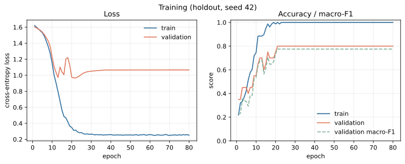
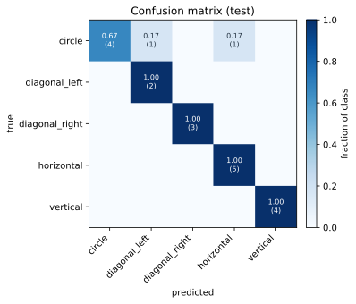
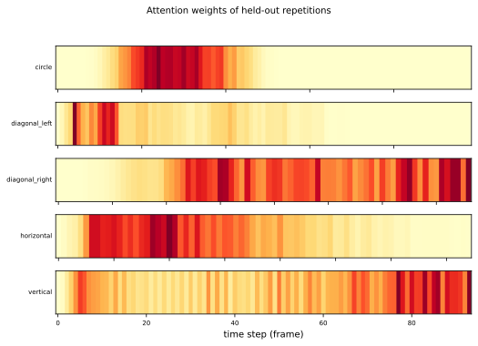
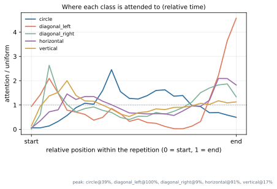

# Explainable Rehabilitation Motion Classification

An LSTM with attention pooling that reads raw motion-capture recordings of
rehabilitation exercises and says **which exercise was performed** and **which
part of the movement drove that decision**.

[](https://github.com/lmm0125-art/machine-learning/actions/workflows/ci.yml)
[](pyproject.toml)
[](LICENSE)

Course project for *Machine Learning (IC-PBL), 2025-Fall*, Hanyang University — Prof. Yongjae Yoo, industry mentor Dr. Young Hoon Ji (Hexar Humancare). Evaluated on both course releases: Data1 (34 recordings) and the noisy Data2 (28 recordings).

```
recording  ──►  split into repetitions  ──►  z-score  ──►  LSTM  ──►  attention  ──►  class
   .txt            (the `s` markers)                        encoder    pooling
                                                                        │
                                                                        └──►  heat-map over time
```

## Results

### Data1 — 34 recordings, 118 repetitions

Stratified 5-fold **group** cross-validation (3 seeds × 5 folds = 15 runs).
"Per repetition" scores a single movement cycle; "per recording" pools the 3–5
cycles of one recording, which is the question the project actually asks.

| model | per repetition | per recording |
|---|---|---|
| LSTM + attention (this repo) | 0.790 ± 0.081 | **0.931 ± 0.091** |
| SVM (RBF) on summary statistics | **0.880 ± 0.107** | 0.892 ± 0.116 |
| logistic regression on summary statistics | 0.853 ± 0.109 | 0.892 ± 0.116 |

Per-recording macro-F1 of the LSTM: **0.902 ± 0.133**.

### Data2 — 28 recordings, 94 repetitions

Data2 is the noisy second release. The rows separate three questions: how a
Data1-only model transfers, how a model trained on Data2 alone does, and whether
adding Data1 to the training folds helps.

| training data | model | per repetition | per recording | per-recording macro-F1 |
|---|---|---|---|---|
| Data1 only | LSTM + attention | 0.702 | 0.821 | 0.824 |
| Data2 only | LSTM + attention | 0.571 ± 0.167 | 0.656 ± 0.241 | 0.536 ± 0.254 |
| Data2 only | SVM (RBF) | 0.849 ± 0.098 | 0.907 ± 0.130 | 0.720 ± 0.172 |
| Data2 only | logistic regression | 0.841 ± 0.115 | 0.918 ± 0.130 | 0.736 ± 0.168 |
| Data1 + Data2 | LSTM + attention | 0.780 ± 0.094 | 0.884 ± 0.134 | 0.706 ± 0.196 |
| Data1 + Data2 | SVM (RBF) | **0.939 ± 0.046** | 0.964 ± 0.071 | 0.784 ± 0.157 |
| Data1 + Data2 | logistic regression | 0.908 ± 0.079 | **0.967 ± 0.067** | **0.788 ± 0.153** |

**Best result on Data2: logistic regression trained on Data1 + Data2 — 0.967 ±
0.067 per-recording accuracy and 0.788 ± 0.153 per-recording macro-F1.** The best
LSTM result is 0.884 ± 0.134 per recording; its unique output remains the
per-timestep attention map. On single cycles the SVM is strongest (0.939 ± 0.046).
The Data1-only row is a single release checkpoint scored on all of Data2; the
other rows are 15-run CV means.

The classical baseline wins on single cycles on both releases — with 34 and 28
recordings that is the honest result, not a bug. On Data1 the LSTM's advantage
appears once repetitions of a recording are pooled; on Data2 even the pooled
decision is better with logistic regression. The LSTM's unique output remains the
per-timestep attention map, which a summary-statistics model cannot produce. See
[`docs/REPORT.md`](docs/REPORT.md) §6 for the discussion.

| | |
|---|---|
|  |  |
|  |  |

## Quickstart

```bash
git clone https://github.com/lmm0125-art/machine-learning.git
cd machine-learning
python -m venv .venv && source .venv/bin/activate
pip install -e ".[dev]"
```

Put the recordings under `data/raw/<class>/*.txt` and `data/raw2/<class>/*.txt`
(see [`data/README.md`](data/README.md) — the data is course material and is
**not** in this repository), then:

```bash
python scripts/check_data.py --root data/raw        # sanity check, Data1
python scripts/check_data.py --root data/raw2       # sanity check, Data2
python -m pytest -q                                 # 8 tests

# Data1: 5-fold group CV, 3 seeds, refit on everything at the end
python -m rehab_cls.train --data-root data/raw --out-dir runs/release \
    --cv 5 --seeds 3 --features raw_delta --per-recording-norm \
    --hidden 96 --dropout 0.4 --epochs 80 --patience 0 --train-final

# Data2: train on Data1 + Data2 folds, test on held-out Data2 recordings
python -m rehab_cls.train --data-root data/raw2 --extra-data-root data/raw \
    --out-dir runs/data2 --cv 5 --seeds 3 --val-frac 0.25 \
    --features raw_delta --per-recording-norm \
    --hidden 96 --dropout 0.4 --epochs 80 --patience 15

# same protocol for the classical baselines
python -m rehab_cls.baseline --data-root data/raw2 --extra-data-root data/raw \
    --cv 5 --seeds 3 --out-json results/data2_baseline_with_data1_metrics.json

# score a checkpoint, write the report figures
python -m rehab_cls.evaluate --checkpoint runs/holdout/checkpoint.pt \
    --data-root data/raw --split test --figures-dir docs/figures

# unlabelled demo folder -> CSV + attention heat-maps
python -m rehab_cls.predict --checkpoint runs/release/checkpoint_final.pt \
    --input data/demo --out-dir runs/predict
```

`predict` writes two tables: one row per repetition and one row per recording
(probability-averaged, plus a `vote_agreement` column that exposes how much the
repetitions of a recording disagreed — a free uncertainty signal).

## How it works

**Data.** Each recording holds 3–5 repetitions delimited by `s,0,,#` lines.
Data1 contains 34 recordings / 148 repetitions; Data2 contains 28 recordings /
120 repetitions. Repetitions shorter than 40 frames (truncated warm-up/tail) are
dropped, leaving 118 and 94 respectively. Treating a whole file as one sample —
what the first version of this project did — discards most of the available
repetitions and averages the attention map over several cycles.
Eight of the 28 raw channels are recording metadata (frame counter, timestamp) or
constant zero, and are dropped.

**Model.** A single-layer LSTM (96 hidden units, dropout 0.4) encodes the
sequence; additive attention pools the hidden states into one vector; a linear
head classifies it. Padded time steps are masked with `-inf` *before* the softmax
and the encoder consumes a packed sequence, so neither the recurrence nor the
attention ever sees padding.

**Training.** Feature standardisation is fitted on the training split only;
time warping, jitter and amplitude scaling augment the ~80 training repetitions;
AdamW with gradient clipping; early stopping or a fixed budget depending on the
protocol. Everything is seeded.

**Split discipline.** Splitting is done on **recordings**, never on single
repetitions: repetitions of the same recording are strongly correlated, and
splitting them randomly inflates the score.

## Repository layout

```
src/rehab_cls/
├── data.py        parsing, repetition splitting, scaling, augmentation, loaders
├── model.py       AttentionLSTM (masked attention, packed LSTM)
├── train.py       CV / hold-out training, metrics, checkpoint
├── evaluate.py    scoring + report figures
├── predict.py     unlabelled inference with per-recording voting
├── baseline.py    classical comparison (logreg, SVM on summary statistics)
├── metrics.py     accuracy, macro-F1, per-class report, confusion matrix
├── plotting.py    figures
└── utils.py       seeds, device, checkpoint I/O
tests/             8 unit tests (parsing, masking, split integrity, ...)
scripts/           check_data.py, run_all.sh, run_data2.sh
docs/              REPORT.md, CODE_REVIEW.md, figures/
legacy/            ml_code.ipynb — the original submission, unchanged
```

## Reproducing every number

`scripts/run_all.sh` runs the whole Data1 chain (ablation → release → evaluation
→ baseline → demo predictions) and `scripts/run_data2.sh` reproduces the Data2
table (Data2-only CV, transfer, and Data1+Data2 training). Every run writes
`metrics.json` with the exact argument vector, so a number in the report can be
traced back to one command.

## What the attention shows

The class-averaged profile is nearly flat, which is the truthful finding: the
model spreads attention over most of the repetition rather than locking onto one
"key frame". Individual repetitions do show sharp peaks (see the figure above),
so the mechanism works per sample, but there is no single frame that defines
"circle" for every subject. Treating attention as a per-sample explanation is
supported; treating it as a per-class saliency map is not.

## Limitations

* 34 + 28 recordings across two releases, with one recording session per class in
  Data1 — cross-subject generalisation is still untested.
* Data2 is smaller and noisier: 94 usable repetitions after filtering. The LSTM
  trained on Data2 alone reaches 0.656 per recording; adding Data1 to the
  training folds lifts it to 0.884.
* On Data2 the best result comes from logistic regression (0.967 per recording),
  not the LSTM. The LSTM is kept for its per-timestep attention output, not as
  the accuracy leader.
* Recording-level accuracy benefits from averaging 3–5 repetitions; a recording
  with a single cycle would score closer to the per-repetition number.

## Team

See [`CONTRIBUTORS.md`](CONTRIBUTORS.md) for who did what.
bubble team — WANG YUMING, 우시시, 이멍멍, 유열.

## Licence

MIT for the code (see [`LICENSE`](LICENSE)). The recordings belong to Hanyang
University and Hexar Humancare and are not redistributed here.
