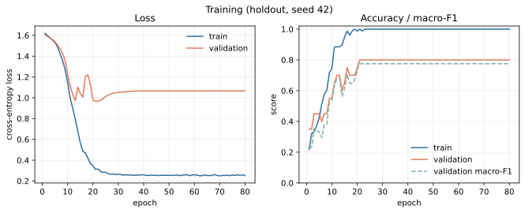
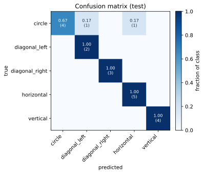
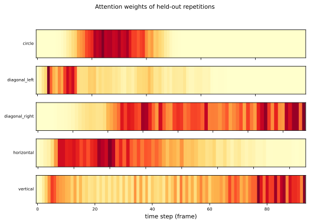
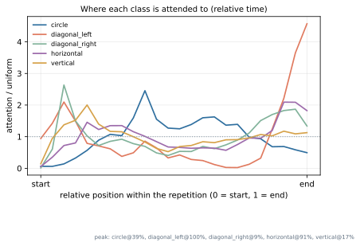

# Explainable Rehabilitation Motion Classification

An LSTM with attention pooling that reads raw motion-capture recordings of
rehabilitation exercises and says **which exercise was performed** and **which
part of the movement drove that decision**.

[](https://github.com/lmm0125-art/machine-learning/actions/workflows/ci.yml)
[](pyproject.toml)
[](LICENSE)

Course project for *Machine Learning (IC-PBL), 2025-Fall*, Hanyang University — Prof. Yongjae Yoo, industry mentor Dr. Young Hoon Ji (Hexar Humancare).

```
recording  ──►  split into repetitions  ──►  z-score  ──►  LSTM  ──►  attention  ──►  class
   .txt            (the `s` markers)                        encoder    pooling
                                                                        │
                                                                        └──►  heat-map over time
```

## Results

Stratified 5-fold **group** cross-validation over the 34 recordings
(3 seeds × 5 folds = 15 runs). "Per repetition" scores a single movement cycle;
"per recording" pools the 3–5 cycles of one recording, which is the question the
project actually asks.

| model | per repetition | per recording |
|---|---|---|
| LSTM + attention (this repo) | 0.790 ± 0.081 | **0.931 ± 0.091** |
| SVM (RBF) on summary statistics | **0.880 ± 0.107** | 0.892 ± 0.116 |
| logistic regression on summary statistics | 0.853 ± 0.109 | 0.892 ± 0.116 |

Per-recording macro-F1 of the LSTM: **0.902 ± 0.133**.

The classical baseline wins on single cycles — with 34 recordings that is the
honest result, not a bug. The LSTM's advantage appears once repetitions of a
recording are pooled, and its unique output is the per-timestep attention map,
which a summary-statistics model cannot produce. See
[`docs/REPORT.md`](docs/REPORT.md) §6 for the discussion.

| | |
|---|---|
|  |  |
|  |  |

## Quickstart

```bash
git clone https://github.com/lmm0125-art/machine-learning.git
cd machine-learning
python -m venv .venv && source .venv/bin/activate
pip install -e ".[dev]"
```

Put the recordings under `data/raw/<class>/*.txt` (see [`data/README.md`](data/README.md) —
the data is course material and is **not** in this repository), then:

```bash
python scripts/check_data.py --root data/raw        # sanity check
python -m pytest -q                                 # 8 tests

# 5-fold group CV, 3 seeds, refit on everything at the end
python -m rehab_cls.train --data-root data/raw --out-dir runs/release \
    --cv 5 --seeds 3 --features raw_delta --per-recording-norm \
    --hidden 96 --dropout 0.4 --epochs 80 --patience 0 --train-final

# score a checkpoint, write the report figures
python -m rehab_cls.evaluate --checkpoint runs/holdout/checkpoint.pt \
    --data-root data/raw --split test --figures-dir docs/figures

# unlabelled demo folder -> CSV + attention heat-maps
python -m rehab_cls.predict --checkpoint runs/release/checkpoint_final.pt \
    --input data/demo --out-dir runs/predict
```

`predict` writes two tables: one row per repetition and one row per recording
(probability-averaged, plus a `vote_agreement` column that exposes how much the
repetitions of a recording disagreed — a free uncertainty signal).

## How it works

**Data.** Each recording holds 3–5 repetitions delimited by `s,0,,#` lines, 148
repetitions in total across the dataset. Repetitions shorter than 40 frames
(truncated warm-up/tail) are dropped, leaving 118. Treating a whole file as one
sample — what the first version of this project did — discards 71 % of the
available repetitions and averages the attention map over several cycles.
Eight of the 28 raw channels are recording metadata (frame counter, timestamp) or
constant zero, and are dropped.

**Model.** A single-layer LSTM (96 hidden units, dropout 0.4) encodes the
sequence; additive attention pools the hidden states into one vector; a linear
head classifies it. Padded time steps are masked with `-inf` *before* the softmax
and the encoder consumes a packed sequence, so neither the recurrence nor the
attention ever sees padding.

**Training.** Feature standardisation is fitted on the training split only;
time warping, jitter and amplitude scaling augment the ~80 training repetitions;
AdamW with gradient clipping; early stopping or a fixed budget depending on the
protocol. Everything is seeded.

**Split discipline.** Splitting is done on **recordings**, never on single
repetitions: repetitions of the same recording are strongly correlated, and
splitting them randomly inflates the score.

## Repository layout

```
src/rehab_cls/
├── data.py        parsing, repetition splitting, scaling, augmentation, loaders
├── model.py       AttentionLSTM (masked attention, packed LSTM)
├── train.py       CV / hold-out training, metrics, checkpoint
├── evaluate.py    scoring + report figures
├── predict.py     unlabelled inference with per-recording voting
├── baseline.py    classical comparison (logreg, SVM on summary statistics)
├── metrics.py     accuracy, macro-F1, per-class report, confusion matrix
├── plotting.py    figures
└── utils.py       seeds, device, checkpoint I/O
tests/             8 unit tests (parsing, masking, split integrity, ...)
scripts/           check_data.py, run_all.sh
docs/              REPORT.md, CODE_REVIEW.md, figures/
legacy/            ml_code.ipynb — the original submission, unchanged
```

## Reproducing every number

`scripts/run_all.sh` runs the whole chain (ablation → release → evaluation →
baseline → demo predictions) and drops the metrics into `runs/`. Every run writes
`metrics.json` with the exact argument vector, so a number in the report can be
traced back to one command.

## What the attention shows

The class-averaged profile is nearly flat, which is the truthful finding: the
model spreads attention over most of the repetition rather than locking onto one
"key frame". Individual repetitions do show sharp peaks (see the figure above),
so the mechanism works per sample, but there is no single frame that defines
"circle" for every subject. Treating attention as a per-sample explanation is
supported; treating it as a per-class saliency map is not.

## Limitations

* 34 recordings, one recording session per class — cross-subject generalisation
  is untested.
* Only the first dataset (`Data1`) plus an unlabelled demo set are evaluated
  here. The noisy second set (week 13) is not part of these numbers, so the
  robustness claim of the original report is not supported by this repository.
* Recording-level accuracy benefits from averaging 3–5 repetitions; a recording
  with a single cycle would score closer to the per-repetition number.

## Team

See [`CONTRIBUTORS.md`](CONTRIBUTORS.md) for who did what.
bubble team — WANG YUMING, 우시시, 이멍멍, 유열.

## Licence

MIT for the code (see [`LICENSE`](LICENSE)). The recordings belong to Hanyang
University and Hexar Humancare and are not redistributed here.
