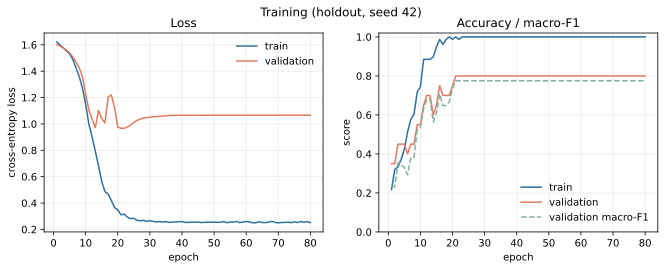
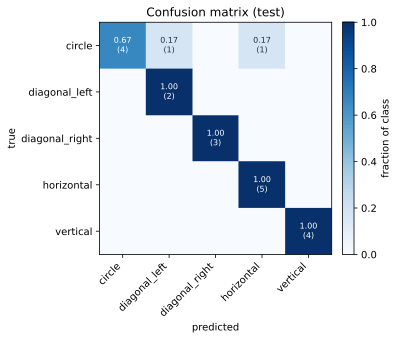
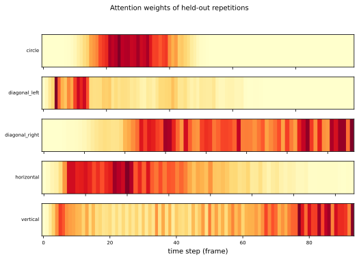
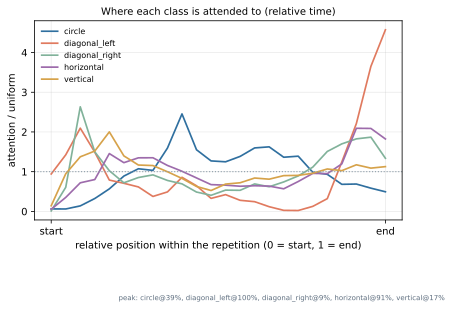

# Explainable Classification of Rehabilitation Exercise Trajectories with an LSTM and Attention Pooling

*Hanyang University — Machine Learning (IC-PBL), 2025-Fall — bubble team*

---

## 1. Objective

Rehabilitation exercises are prescribed as short sets of repetitive movements.
Whether a patient actually performed the prescribed movement is normally judged
by a therapist watching the session. We ask whether the same judgement can be
made from the recorded trajectory alone, and — because a classifier that says
"circle, 0.97" without saying *why* is of little use to a clinician — whether the
model can point at the part of the movement that produced the decision.

Two requirements follow from that framing:

1. **Classify** which of five exercises (circle, diagonal_left, diagonal_right,
   horizontal, vertical) a recording contains.
2. **Localise** the decision in time, so that the output can be inspected next to
   the trajectory.

The dataset is deliberately small, so a third implicit requirement is that the
evaluation must survive scrutiny: no leakage, no selection on the test set, and
error bars rather than a single lucky number.

## 2. Data

Each recording is a text file of frames sampled at roughly 50 Hz. A frame carries
28 numbers: a frame counter, a timestamp in milliseconds, four joint angles, four
angular velocities, an accelerometer block, a position block, and three further
3-D blocks. Two structural facts drive the whole pipeline:

* **Repetitions are delimited.** The line `s,0,,#` marks the boundary between two
  repetitions of the same exercise. The 34 recordings contain 148 repetitions in
  total.
* **Half the channels are inert.** Columns 0 and 1 are monotone counters
  (10 295 – 3 316 011) and columns 10–13, 17, 18 are exactly zero in every frame
  of the released data. They are removed, leaving 20 channels; first differences
  are optionally appended, giving 40.

After dropping repetitions shorter than 40 frames — the truncated head and tail
of each recording, some as short as a single frame — 118 repetitions remain.
Recordings are the unit of the split; repetitions are the unit of prediction.

## 3. Method

### 3.1 Preprocessing

*Split into repetitions.* A whole recording concatenates three to five cycles, so
its attention map would be an average over cycles. Splitting on `s` turns 34
samples into 118 and makes each attention map correspond to one movement.

*Remove recording-level offset.* Sensor placement and posture shift all channels
by a constant per session. Each recording is standardised against its own mean
and standard deviation before training.

*Global standardisation.* Channel magnitudes span 60 (joint angles) to 1.9 × 10⁴
(linear acceleration). A `FeatureScaler` fitted **on the training split only**
centres and scales each channel and clips at ±5σ.

*Augmentation.* Time warping (×0.85–1.15), amplitude scaling (±5 %) and Gaussian
jitter (σ = 0.05 on standardised channels) are applied to the training
repetitions. All three preserve the class; they only make the network less able
to memorise the exact recordings.

### 3.2 Model

An LSTM [1] encodes the sequence, an additive attention layer [2] pools it:

```
h_t        = LSTM(x_t, h_{t-1})                       t = 1 … T
e_t        = vᵀ tanh(W h_t + b)                       (attention score)
α_t        = softmax_t(e_t)   with e_t = -∞ on padding
c          = Σ_t α_t h_t                              (context vector)
ŷ          = softmax(W_c · dropout(c) + b_c)
```

Two implementation details matter for correctness rather than performance:

* the softmax is taken over **valid** time steps only — padded positions get
  `-inf` before the softmax, so `α_t = 0` exactly there;
* the encoder consumes a `pack_padded_sequence`, so padded frames never enter the
  recurrence and the hidden state at `t = T` is the true end of the movement.

The network has 96 hidden units, one layer, dropout 0.4 and a linear classifier
head: 63 k parameters, small on purpose, because ~80 training repetitions cannot
support more.

### 3.3 Why attention here

Attention [2, 3] is not needed to reach a good accuracy on this dataset; a
summary-statistics model does at least as well (§5). It is included because it is
the only component that produces a *localised* explanation: `α_t` is a
distribution over time steps, so it can be plotted underneath the trajectory and
compared with what a therapist would point at. Whether such weights are faithful
explanations is contested [4, 5]; we therefore treat them as evidence to be
inspected, not as a proof of causality.

### 3.4 Training and evaluation protocol

AdamW (lr 1 × 10⁻³, weight decay 1 × 10⁻⁴), cross-entropy with label smoothing
0.05, gradient clipping at norm 5, batch size 16, 80 epochs.

Because 34 recordings make a single split extremely noisy, the headline numbers
come from **stratified 5-fold group cross-validation over recordings**, repeated
with three seeds (15 runs). Folds are built with `StratifiedGroupKFold` on
recording identifiers, so no repetition of a test recording ever appears in
training. The normaliser is fitted inside each fold. A single seeded hold-out
split is reported separately, and is the one used for the figures.

## 4. Implementation

The code is organised as an installable package (`pip install -e .`) with four
entry points: `rehab_cls.train`, `.evaluate`, `.predict`, `.baseline`. A
checkpoint stores the weights **and** the model configuration, the label order,
the scaler statistics, the dropped columns and the recording-level split, so
inference rebuilds exactly the network that was trained and refuses to load a
mismatched one (`strict=True`).

The demo path (`rehab_cls.predict`) parses an unlabelled folder, predicts every
repetition and aggregates the per-repetition probabilities into one answer per
recording, together with a `vote_agreement` column — the fraction of repetitions
that voted for the winning class, i.e. a free uncertainty estimate.

## 5. Results

Per-repetition and per-recording scores, mean ± standard deviation over 15 runs:

| model | per repetition acc | per repetition macro-F1 | per recording acc | per recording macro-F1 |
|---|---|---|---|---|
| LSTM + attention | 0.790 ± 0.081 | 0.767 ± 0.103 | **0.931 ± 0.091** | **0.902 ± 0.133** |
| SVM (RBF), summary statistics | **0.880 ± 0.107** | **0.853 ± 0.142** | 0.892 ± 0.116 | 0.869 ± 0.149 |
| logistic regression, summary statistics | 0.853 ± 0.109 | 0.821 ± 0.142 | 0.892 ± 0.116 | 0.870 ± 0.150 |

The hold-out split (7 test recordings, 20 repetitions) gives 0.900 per
repetition and 1.000 per recording; the cross-validation numbers above are the
ones to quote, because a single split with 7 recordings is worth ±0.1 on its own.



*Fig. 1 — training and validation curves of the hold-out run. Validation macro-F1
saturates around epoch 25 and the train loss keeps falling: the model is
over-fitting from that point, which is why the reported number is the
cross-validated one and not this run.*



*Fig. 2 — confusion matrix of the hold-out split, normalised per class. Both
errors land in the `circle` row.*

Ablation (5-fold CV, 64 hidden, one seed):

| features | per repetition | per recording |
|---|---|---|
| raw, global scaling | 0.767 ± 0.069 | 0.852 ± 0.091 |
| + first differences | **0.812** ± 0.103 | 0.848 ± 0.106 |
| + per-recording normalisation | 0.795 ± 0.058 | 0.881 ± 0.109 |
| + both | 0.750 ± 0.069 | **0.914** ± 0.114 |

Two things are worth reading out of this table. First, the two feature additions
help at *different* granularities: velocity channels sharpen the single cycle,
per-recording normalisation mostly helps the pooled decision. Second, the
differences between rows are within one standard deviation, so with 34 recordings
we should not over-interpret the ordering.

## 6. Discussion

**The classical baseline is competitive, and that is the finding.** A linear model
on six summary statistics per channel classifies single repetitions better than
the recurrent network (0.88 vs 0.79). With 34 recordings this is expected: a
global summary is a strong prior, and an LSTM has to learn the same invariances
from very few examples. The LSTM only pulls ahead once the repetitions of a
recording are pooled (0.93 vs 0.89), which is precisely the multi-cycle evidence
the summary model throws away by averaging. We report this rather than tuning the
baseline down: the honest claim is that the recurrent model buys *localisation*,
not accuracy, on data of this size.

**Attention does not collapse to one frame.** The class-averaged attention
profile is close to uniform (Fig. 4), while individual repetitions show sharp
peaks at different positions. A plausible reading is that the network integrates
the whole cycle and that the peak location depends on speed and starting phase
rather than on a class-specific key frame. This is consistent with the critique
that attention weights are not automatically explanations [4, 5]: they are
per-sample evidence, useful to a clinician inspecting one recording, not a
class-level saliency map.



*Fig. 3 — attention weights of five held-out repetitions, one per class. The
peak sits at a different position in every repetition.*



*Fig. 4 — class-averaged attention as a function of relative position in the
repetition, divided by the uniform baseline. The curves stay within a factor of
about four of uniform and do not share a common peak.*

**Where the errors are.** In the hold-out confusion matrix (Fig. 2) both errors involve
`circle`: one was read as `diagonal_left`, one as `horizontal`, while the other
four classes were classified perfectly. A circle and a diagonal stroke pass through similar positions with
similar speeds; the difference is the curvature reversal, which is a second-order
property of the trajectory. The channels that would make it obvious (the constant
zero accelerometer block) are missing from this release.

**Edge cases encountered.**

* *Truncated repetitions.* 18 of 148 repetitions are shorter than 20 frames; they
  come from the beginning and end of a recording and contain a partial movement.
  Keeping them hurt validation accuracy, so they are filtered out by a minimum
  length instead of being padded.
* *Variable-length batches.* Repetitions range from 40 to 100 frames. Padding
  without masking was the original implementation's silent problem: attention
  spent part of its budget on zero rows. Masking fixed both the accuracy and the
  interpretability of the heat-maps.
* *Long sessions.* One demo recording contains 10 repetitions instead of the
  usual 3–5 and its repetitions disagree (vote agreement 0.60). The agreement
  column flags exactly the recordings a clinician should re-inspect.
* *Class imbalance.* Counts are 21/22/25/27/23 repetitions, mild enough that
  class weighting was not needed; macro-F1 is reported alongside accuracy in case
  a future release is less balanced.

**Limitations.** Cross-subject generalisation is untested: the dataset has one
recording session per class, so the per-recording normalisation may be doing work
that a second subject would break. Only the first dataset is evaluated here; the
noisy second set was not part of these experiments, so robustness to noise
remains an open question. Finally, 34 recordings put a floor under the standard
deviation: differences below roughly 0.1 in the tables above should not be read
as real.

## 7. Conclusion

A small LSTM with masked attention pooling classifies rehabilitation exercise
recordings at 0.93 accuracy per recording under group cross-validation, while
producing a per-timestep attention map that can be inspected next to the
trajectory. The honest summary of the experiments is narrower than "deep learning
beats classical methods": on 34 recordings a summary-statistics model is at least
as accurate per movement cycle, and the recurrent model's contribution is the
pooled multi-cycle decision and the temporal localisation. Future work should add
subjects, add the noisy release, and test whether the attention peaks agree with
therapists' annotations — which is the only way to know whether the explanation is
useful rather than merely presentable.

## References

[1] Hochreiter, S., & Schmidhuber, J. (1997). Long short-term memory. *Neural Computation*, 9(8), 1735–1780.

[2] Bahdanau, D., Cho, K., & Bengio, Y. (2015). Neural machine translation by jointly learning to align and translate. *ICLR*.

[3] Sutskever, I., Vinyals, O., & Le, Q. V. (2014). Sequence to sequence learning with neural networks. *NeurIPS*.

[4] Jain, S., & Wallace, B. C. (2019). Attention is not Explanation. *NAACL-HLT*.

[5] Wiegreffe, S., & Pinter, Y. (2019). Attention is not not Explanation. *EMNLP-IJCNLP*.

[6] Ordóñez, F. J., & Roggen, D. (2016). Deep convolutional and LSTM recurrent neural networks for multimodal wearable activity recognition. *Sensors*, 16(1), 115.

[7] Ronao, C. A., & Cho, S.-B. (2016). Human activity recognition with smartphone sensors using deep learning neural networks. *Expert Systems with Applications*, 59, 235–244.

[8] Ismail Fawaz, H., Forestier, G., Weber, J., Idoumghar, L., & Muller, P.-A. (2019). Deep learning for time series classification: a review. *Data Mining and Knowledge Discovery*, 33(4), 917–963.

[9] Bulling, A., Blanke, U., & Schiele, B. (2014). A tutorial on human activity recognition using body-worn inertial sensors. *ACM Computing Surveys*, 46(3), 1–33.

[10] Pedregosa, F., et al. (2011). Scikit-learn: Machine learning in Python. *Journal of Machine Learning Research*, 12, 2825–2830.
